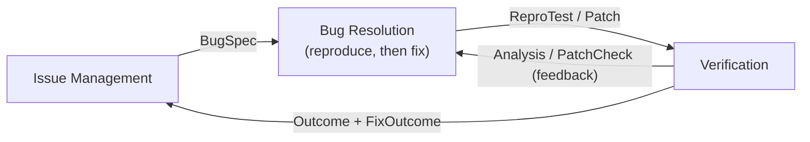
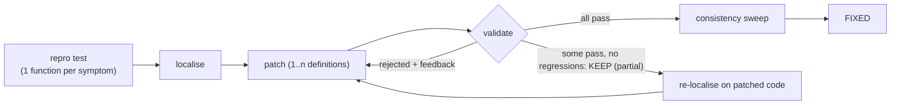
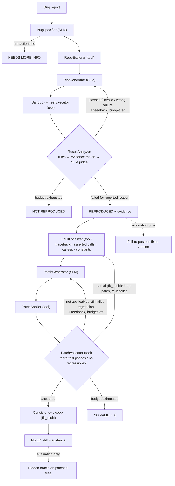

# ReproAgent architecture

ReproAgent turns a written bug report into an **executable pytest test that fails because of the reported bug**, and then **fixes the bug**: it proposes a patch that makes that test pass without breaking existing tests. Everything runs on a locally hosted Small Language Model (SLM).
We derived the architecture with the course's domain-driven method: use case → bounded contexts → shared models → hidden modules → classification → number of agents.

> **Change after the mid-term review:** the proposal had automatic fixing out of scope. On the instructor's request, bug resolution was added. Reproduction stays the first phase: a fix is attempted only after a reproduction test has been accepted. That test is used to localise the fault and to validate the patch.

## 1. Use case

The course's reference use case is *autonomous bug fixing* (understand bug → explore repo → root cause → fix → validate → report). ReproAgent now covers all of it, with reproduction as an explicit, checkable step before fixing:

| Bug-fixing step (slides) | ReproAgent step |
|---|---|
| Understand the bug | 1. Read the report, extract expected vs. observed behaviour |
| Explore repository | 2. Search the project for relevant functions and modules |
| *(new: make the bug executable)* | 3–5. **Generate a reproduction test**, run it in a sandbox, refine it with execution feedback |
| Identify root cause | 6. **Fault localisation** driven by the failing test: traceback frames, the API the test calls, their callees and the constants they read |
| Implement a fix | 7. **Patch generation**: the SLM rewrites the suspicious definition(s) |
| Validate the fix | 8. **Patch validation** in a sandbox: the reproduction test must now pass and related existing tests must not regress. Refine with feedback |
| Report the outcome | 9. Verdict (reproduced / not reproduced / needs more information) + fix status + diff + evidence |

Running example (from the slides): *"Discount is incorrectly applied to orders below ₹1,000"* (bug `shop_discount`). ReproAgent writes a test showing that an ₹800 order gets an ₹80 discount. It then localises `checkout → bulk_discount → DISCOUNT_THRESHOLD` (the buggy constant is 100) and patches `bulk_discount` to compare against ₹1,000 (validated: the test passes, no regressions; the hidden oracle confirms it is correct).

## 2. Bounded contexts

The contexts are the same three as on the slides. **Bug Resolution** has two phases: *reproduction* (test generation) and *fixing* (localisation + patch generation). **Verification** checks both artefacts: the test (does it fail for the reported reason?) and the patch (does the test now pass, without regressions?).

## 3. Shared models (`reproagent/models.py`)

| Between | Shared model | Fields |
|---|---|---|
| Issue Mgmt → Bug Resolution | `BugReport`, **`BugSpec`** (behaviour, acceptance criteria) | expected, observed, symbols, files, example inputs, failure kind, actionable? |
| Bug Resolution → Verification | **`ReproTest`** | attempt no., test code, raw SLM output |
| Bug Resolution → Verification | **`Patch`** (the slides' "proposed patch") + `FaultCandidate`s | replaced definitions, unified diff, patched files |
| Verification → Bug Resolution | **`Analysis`**, **`PatchCheck`** (feedback) | category, accepted?, feedback text, regressions |
| Verification → Issue Mgmt / user | **`Outcome`**, **`FixOutcome`** (failures, status, report) | verdict, attempts, final test, evidence, fix status, final diff, time, #SLM calls; evaluation-only fail-to-pass and hidden-oracle results |

## 4. Hidden modules and 5. classification

| Bounded context | Module | Classification | Implementation |
|---|---|---|---|
| Issue Management | Issue Retrieval | Function/Tool | `IssueRetrieval`: JSON/Markdown file or public GitHub issue URL (REST API) |
| | Bug Specification | AI capability (+ regex fallback) | `BugSpecifier`: SLM in JSON mode, merged with deterministic identifier/path extraction |
| Bug Resolution | Repository Explorer | Function/Tool | `RepoExplorer`: AST index of all definitions, symbol/keyword ranking, mines imports and call sites from existing tests |
| | Test Designer/Generator | AI capability | `TestGenerator`: SLM writes the pytest file; on retries it also sees the last attempt and its feedback |
| | **Fault Localizer** (root cause) | Function/Tool | `FaultLocalizer`: ranks definitions using (1) project frames in the failing traceback, (2) the calls whose result the test asserts, then the last action before the assert, (3) symbols in the report, (4) one level of callees, (5) module constants they read, (6) report vocabulary |
| | **Patch Generator** (code modifier) | AI capability | `PatchGenerator`: the SLM returns the *complete new version* of the definitions it changes. That is more robust for a 3B model than a diff with line numbers |
| | **Patch Applier** | Function/Tool | `PatchApplier`: splices the definitions into the files at their AST positions (methods into their class), adds imports, checks syntax, produces a unified diff. One answer may replace **several definitions in several files** |
| | **Consistency sweep** (multi-location) | Tool + AI capability | `find_siblings` (tool): finds definitions that still contain the code pattern the patch replaced (token-level match, e.g. the same `>` vs `>=` mistake). The SLM then decides whether the same mistake is there and returns those fixes, or `NONE` |
| Verification | Test Executor (sandbox) | Function/Tool | `Sandbox` + `TestExecutor`: isolated copy of the repo, pytest subprocess, timeout, structured parse |
| | Result Analyzer | Rules + AI capability | `ResultAnalyzer`: deterministic triage, evidence matching against the report, then an SLM judge as a fallback |
| | **Patch Validator** | Function/Tool | `PatchValidator`: applies the patch in a fresh sandbox, re-runs the reproduction test (must pass), and runs the existing test files that import the patched modules. Only *new* failures count as regressions (baseline from the buggy version). In `fix_multi` it runs **all** reproduction test functions and reports a patch that makes some of them pass without regressions as **`partial`**: the patch is kept |
| | Fail-to-pass checker / hidden oracle | Function/Tool | `FailToPassChecker`, `run_python_check`: **evaluation only**, never fed back to the agent |
| | Message judge (valid by meaning) | Rules + AI capability | `check_with_meaning` + `MessageJudge`: when the only failures on the fixed version are error-message wording differences, the report rule, then a text rule, then the SLM decide whether the messages mean the same thing. **Evaluation only**, reported as a second score next to strict fail-to-pass |

The agent never modifies the user's project. The patch is reported as a diff, plus the validated file contents.

### Multi-location fixes (`fix_multi`)

Many real bugs need changes in more than one place: the same mistake copied into several functions, a caller *and* the function it calls, or code *and* a constant, possibly in different files. `fix_full` handles this only if the 3B model gets every place right in one answer. `fix_multi` adds four mechanisms. Each is a small change to an existing module, so the architecture (3 contexts, 1 agent, fixed workflow) stays the same:

1. **One test function per symptom** (Test Generator): a report that lists several wrong behaviours gets one test function for each, so every location has a failing check.
2. **Multi-location patches** (Patch Generator + Applier): the prompt says the bug may need several definitions or files, and the applier splices all of them.
3. **Cumulative repair with re-localisation** (Validator + Localizer): a patch that fixes some test functions without regressions is kept (`partial`). The next attempt sees the kept diff and the *remaining* failure. Localisation is re-run on the patched code, so it follows the bug to its next location. The final diff is cumulative against the original project.
4. **Consistency sweep** (after an accepted patch): looks for the same mistake in similar code the test does not cover. A sweep patch is accepted only if it passes the same validation; otherwise the earlier patch stays.

## 6. How many agents?

Shared tool layer: issue retrieval, code search (AST index), fault localizer, patch applier, sandboxed test runner, result parser, regression runner.

| Option | Pros | Cons for our setting |
|---|---|---|
| **1 agent, fixed workflow, 5 SLM roles** ✅ | One model in memory. Small focused prompts. Deterministic control flow, so behaviour is reproducible and easy to ablate (H1/H2/H3). The fixer reuses the reproducer's state (explorer index, accepted test, its failure output) without hand-off | Less flexible than free-form tool calling |
| 2 agents (Reproducer + Fixer) | Clean split of the two phases; the fixer could use a bigger model | Both would be the same 3B model on 8 GB RAM. Hand-off must serialise the context. Only one runs at a time anyway, because fixing depends on the reproduction |
| 3 agents (one per context) | Clean mapping to contexts | "Too many agents is never a good pattern": hand-off overhead. 3B models are unreliable at free-form multi-agent tool use |

**Decision:** a single agent with a **fixed (scripted) two-phase workflow**. The SLM is used in five narrow roles: specifier, test generator, judge, patch generator and (in `fix_multi`) the consistency-sweep reviewer. The tools are plain Python functions called by the orchestrator, not chosen by the model.
Why: (a) 8 GB RAM fits only one model (qwen2.5-coder:3b, 1.9 GB). (b) 3B models are much less reliable at free-form function calling. A scripted loop removes that failure class. (c) Fixed control flow makes every ablation a configuration switch. (d) Reproduce-then-fix is a strict dependency, so a second agent would add no parallelism.

## Ablation modes (map to hypotheses)

Reproduction:

| Mode | Code context | Execution feedback / retries | Tests |
|---|---|---|---|
| `full_v2` (ReproAgent + symbol-aware feedback) | ✔ | ✔ (budget 4); import, name and attribute errors are answered with the real location and attributes from the AST index | improvement under test |
| `full` (ReproAgent) | ✔ | ✔ (budget 4) | |
| `no_context` | ✘ | ✔ | H1 |
| `single_shot` | ✔ | ✘ (1 attempt) | H2 |
| `baseline` | ✘ | ✘ | simple baseline from proposal |

Fixing (run on every bug with an accepted reproduction test):

| Mode | Reproduction test used for localisation + shown to the SLM | Validation feedback / retries | Tests |
|---|---|---|---|
| `fix_full` | ✔ | ✔ (budget 3) | |
| `fix_single` | ✔ | ✘ (1 attempt) | H2 for fixing |
| `fix_no_repro` | ✘ (report-based localisation only) | ✘ | **H3: reproducing first helps fixing** |
| `fix_multi` | ✔ | ✔ (budget 3) + partial progress kept, re-localisation, consistency sweep (+1 SLM call) | multi-location fixing (`fix_multi` vs `fix_full`) |

Fix metrics: *plausible* = accepted by the agent's own validation. *Correct* = plausible **and** passes a hidden oracle that tests the intended behaviour more broadly (boundary values), so a patch that special-cases the test input is caught.

## Technology

* SLM: `qwen2.5-coder:3b` (open weights, Apache-2.0) served by **Ollama** on localhost. Configurable with `--model`, e.g. `qwen3:8b`.
* Runner: pytest in a subprocess, inside a temporary copy of the project (the original tree is never modified).
* Benchmarks: 12 real bugs from **BugsInPy** (youtube-dl, thefuck, tqdm), materialised from GitHub tarballs + BugsInPy patches. Plus 8 seeded bugs and 1 vague report in the in-house **ShopCart** app, and 5 seeded **multi-location** ShopCart bugs (`benchmarks/multiloc`, each needs 2 changed definitions; `build.py` checks that fixing only one place still fails the hidden oracle). Hidden oracles: `benchmarks/*/oracle_checks.py`.
* Ideas reused from open-source work:
  * BugsInPy's buggy/fixed pairs and the SWE-bench / SWT-bench "fail-to-pass" validity notion.
  * LIBRO (LLM test generation for bug reproduction, Kang et al., ICSE'23).
  * SWE-agent's "agent-computer interface" (small, well-defined tools).
  * Agentless (Xia et al., 2024): localise → repair → validate with reproduction and regression tests, without free-form tool use.
  * The APR distinction between *plausible* and *correct* patches.
