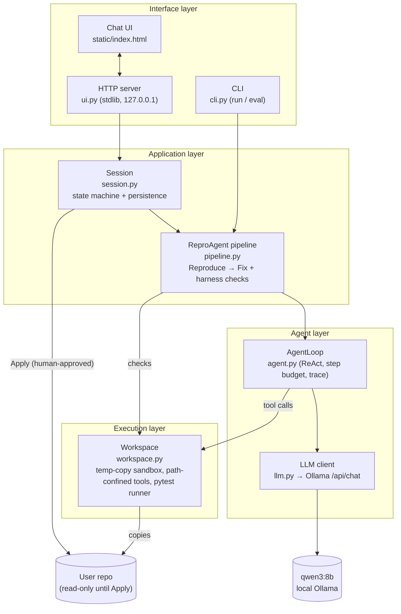
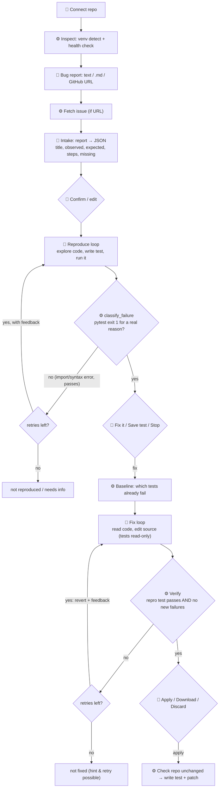
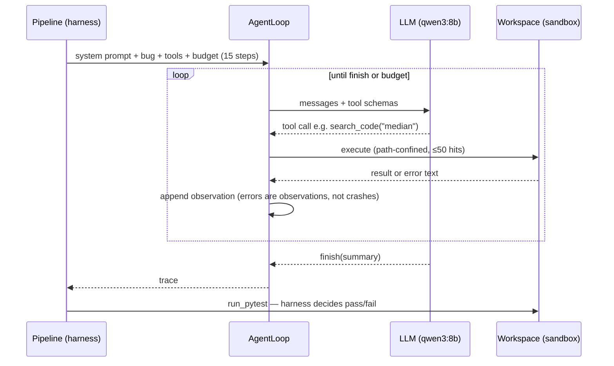
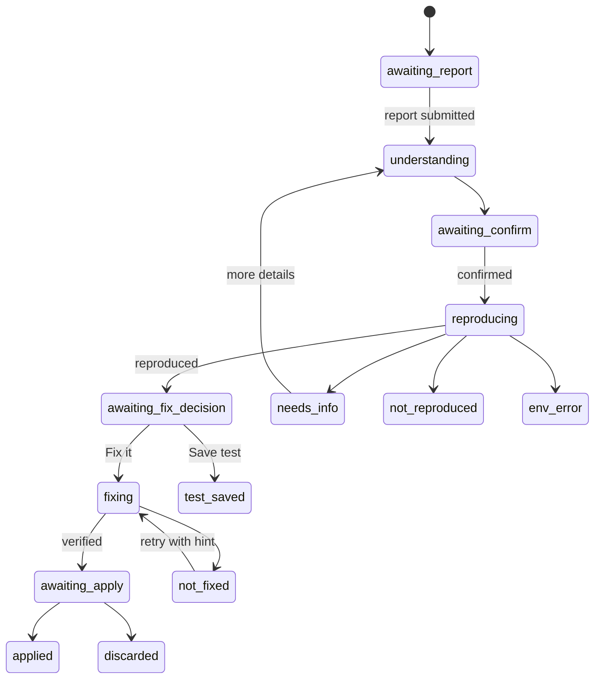
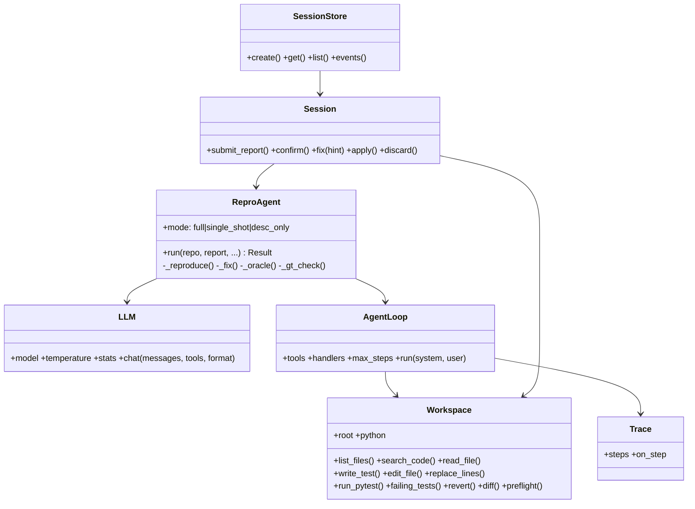

# Architecture

How ReproAgent is built and how the AI fits in. Diagrams are Mermaid (they render on GitHub).
For *why* each decision was made, see [docs/adr/](adr/). For the lecture-concept mapping, see [design-overview.md](design-overview.md).

**Core idea: Agent = model + harness.** The model (`qwen3:8b`, local via Ollama) is frozen. Everything we built is the harness around it: tools, sandbox, budgets, retries, verification, human approval.

---

## 1. Layers (component view)

| Module | Responsibility | Uses AI? |
|---|---|---|
| `llm.py` | Talk to Ollama; count calls, tokens, seconds | is the AI boundary |
| `agent.py` | Generic tool-calling loop: model picks tool → we run it → result back | orchestrates AI |
| `workspace.py` | Sandbox copy; `list_files`, `search_code`, `read_file`, `write_test`, `edit_file`, `run_pytest`, `revert`, `diff` | no |
| `pipeline.py` | Stage order, prompts, retries, all pass/fail decisions | calls AI; **decides without AI** |
| `session.py` | Intake (report → structured bug), session states, Apply | one AI call (intake) |
| `ui.py`, `cli.py` | Entry points | no |

---

## 2. End-to-end flow (where AI is used)

Legend: 🤖 = LLM call · ⚙️ = deterministic code · 🧑 = human

Only **three boxes are AI**. Every diamond (decision) is code or a human — the model never grades itself.

---

## 3. Inside one agent loop (ReAct)

Nested loops (lecture L07): **tool step** (≤15) → **attempt** (≤3 per stage, revert between) → **stage** (reproduce, fix) → **human** (confirm, apply).

---

## 4. Session state machine

Every action is rejected while the session is busy (`_guard`), and sessions persist to `results/sessions/S-XXXX.json`.

---

## 5. Main classes

---

## 6. Safety boundaries

| Risk | Guard |
|---|---|
| Agent edits user files | Works on a temp copy; writes to the real repo only on human **Apply**, and only if the repo hasn't changed since the session started |
| Agent escapes the folder | All paths resolved and confined to the sandbox root |
| Agent "fixes" by editing tests | Test files are read-only in the Fix stage |
| Fake reproduction (import error, assert-the-bug) | `classify_failure` (exit 1 only) + fail-to-pass oracle in evaluation |
| Runaway loops | Step budget, retry budget, pytest timeout |
| Data leaving the machine | Local model only; UI bound to 127.0.0.1 |

---

## 7. Evaluation harness

`cli.py eval` runs each bug in `benchmarks/dataset.json` in three modes (`full`, `single_shot`, `desc_only`) with the same model. Per run it records: reproduced, fail-to-pass on the fixed version, fixed, patch passes the developer's test, LLM calls, tokens, seconds. `benchmarks/summarize.py` turns the JSON into tables.
